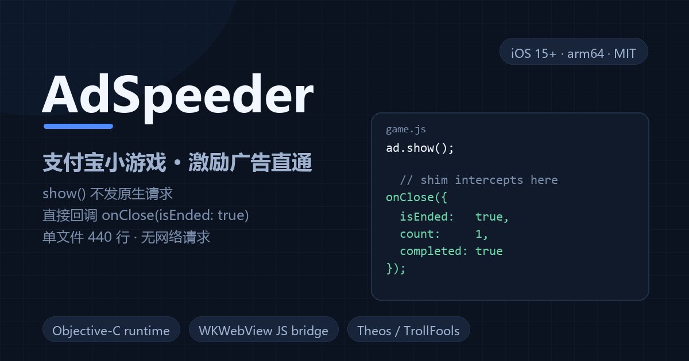

# AdSpeeder



在支付宝小程序 / 小游戏里，把「看广告换奖励」的播放环节直接跳过：
点「观看广告」→ 不播广告 → 游戏立刻收到「已看完」的回调 → 自己发奖励。

> 一个 iOS dylib，用 Objective-C runtime 挂 WKWebView + 注入 JS 两层实现。
> 免费、开源、无网络请求、无上报 —— 除了本仓库代码，不会把任何数据发出去。

[](https://github.com/GGken/Adspeeder/actions/workflows/build.yml)

---

## 一、它到底做了什么

小程序里的激励广告，奖励判定不在原生播放器上，而在**前端 JS**：
游戏调用 `my.createRewardedAd()` 拿到广告对象，注册 `onClose(res)`，
在 `res.isEnded === true` 时发奖。

所以「把视频拖到片尾」没用 —— 视频结束了，倒计时还在走，`isEnded` 依然是 `false`，
奖励照样不到账。真正要改的是那一次回调。

AdSpeeder 就在这一层动手：

```
游戏 JS                       AdSpeeder 注入的 shim                原生
────────────────────────────────────────────────────────────────────────
createRewardedAd()  ────────►  返回包装过的广告对象（记住它）
onClose(cb)         ────────►  存下 cb
show()              ────────►  不发原生请求
                               └─► 立刻 cb({isEnded:true,
                                            count:1,
                                            completed:true})
                                                                    广告从未播放
```

整个流程里，原生广告 SDK 一次都没被调起，所以既没有广告画面，也没有「跳过」动作，
更没有残留的广告浮层。

## 二、两层实现

| 层 | 位置 | 职责 |
|---|---|---|
| **JS 层（主力）** | `WKUserScript`，`documentStart`，`forMainFrameOnly:NO` | 接管 `createRewardedAd` / `createRewardedVideoAd` / `createInterstitialAd`；`show()` 直接回调；`load()` 返回 resolved Promise |
| **原生层（兜底）** | swizzle `WKWebView.initWithFrame:configuration:`、`UIAlertController.alertControllerWithTitle:...` | 补注入后来才出现的 WebView；极少数不走 JS API 的原生广告窗口才处理：隐藏画面、点掉「关闭 / 跳过」、自动选「坚持退出」，1.6 秒后恢复 |

两个关键设计取舍：

1. **开关值不经过页面变量。** 早期版本用 `window.__asFakeAd` 传开关，实测游戏页会把自定义属性弄丢，
   导致 `show()` 时读到 0、广告照样播。现在逻辑写死在注入脚本里，注入即生效。
2. **原生兜底只碰「类名明确像广告」的窗口。** 宿主小程序窗口（顶栏 `···` / `×` 那个胶囊所在）在
   循环第一行就被跳过，不会隐藏、不会点击，用户随时能正常退出小程序。

## 三、适用范围

- 目标 App：支付宝（`com.alipay.iphoneclient`），其它 App 直接跳过、不加载逻辑
- 系统：iOS 15+，arm64
- 广告形态：走小程序 JS API 的激励视频 / 激励浏览 / 插屏
- **不适用**：原生 SDK 渲染、无法在 JS 层拦到的广告（这类只会走兜底，成功率取决于窗口结构）

## 四、编译

不需要 Mac，用 GitHub Actions 就行（本仓库已配好）：

1. fork 或 push 到自己的仓库
2. Actions → `build` → Run workflow
3. 跑完在 artifact 里下载 `AdSpeeder-dylib`
4. 本地产物路径：`.theos/obj/debug/arm64/AdSpeeder.dylib`

想在本地编：

```bash
export THEOS=~/theos
make -j4
```

依赖：Theos + iOS SDK（`TARGET := iphone:clang:latest:15.0`），无第三方库。

## 五、安装

任选一种（都需要对设备有写权限）：

<details>
<summary><b>TrollFools（推荐，无需越狱）</b></summary>

1. 把 `AdSpeeder.dylib` 传到手机
2. TrollFools → 选支付宝 → 注入 dylib
3. **换新版前先删掉旧注入**，两个版本同时跑会互相抢 hook
4. 杀进程重开支付宝（脚本在页面加载时注入，不重开不生效）
</details>

<details>
<summary><b>自签 IPA</b></summary>

把 dylib 放进 `.app/Frameworks/` 并用 `@executable_path/Frameworks/AdSpeeder.dylib`
写进 `Load Commands`（或用 `insert_dylib`），再重签安装。
</details>

<details>
<summary><b>越狱设备</b></summary>

```
/Library/MobileSubstrate/DynamicLibraries/AdSpeeder.dylib
/Library/MobileSubstrate/DynamicLibraries/AdSpeeder.plist   # Filter: com.alipay.iphoneclient
```
</details>

## 六、怎么确认生效了

打开「控制台」App 或 `idevicesyslog`，过滤 `AdSpeeder`：

```
[AdSpeeder] 已加载（WebView hook=1, alert hook=1）
[AdSpeeder] [JS] 已接管 createRewardedAd
[AdSpeeder] [JS] onClose 注册(createRewardedAd)
[AdSpeeder] [JS] show 直通(createRewardedAd)，不发原生请求
[AdSpeeder] [JS] 直接回 onClose isEnded=true cb=有
```

出现最后一行，就说明广告根本没被请求，奖励走的是「看完」分支。

## 七、常见问题

**点了广告还是弹出来？**
游戏大概率没走 `my.createRewardedAd`。看日志里有没有 `已接管` 和 `没找到广告 API（my=undefined）`，
把日志里 `[JS]` 开头的几行贴到 Issue，按实际 API 名补一条拦截即可。

**奖励不到账？**
有的游戏会在 `onClose` 之后再做一次服务端校验（比如要求 `count` 或上报曝光）。
本工具把 `isEnded / count / completed` 都置真，但绕不过服务端风控。

**小程序顶栏不见了？**
旧版本（< 0.4.0）的兜底会按坐标猜关闭按钮，可能误伤胶囊。0.4.0 起原生层只处理
类名像广告的窗口，宿主窗口完全不碰，正常不会出现这个问题。

**会不会上传我的数据？**
不会。源码里没有任何网络请求，日志只打到本机 NSLog。

## 八、目录结构

```
AdSpeeder.m                     全部逻辑（约 440 行，单文件）
Makefile                        Theos library 构建
control                         包信息
AdSpeeder.plist                 越狱环境的注入过滤配置
.github/workflows/build.yml     CI：push 即编译，产物在 artifact
.github/workflows/release.yml   打 tag 即编译并自动发 Release
```

## 九、免责声明

本项目仅用于 **iOS 运行时机制、JavaScript 桥接与 Objective-C swizzling 的学习与研究**。

- 它会让广告不被播放，而奖励照常发放。这会影响广告主与平台的结算，属于**违反平台与广告主协议**的行为。
- 请只在**自己的测试账号**上验证，不要用于任何真实收益、活动或商业场景。
- 使用本工具造成的账号封禁、奖励回收、纠纷或其它后果，由使用者自行承担，作者不提供任何担保。
- 如果你代表平台或广告主并认为本项目侵权，请开 Issue，我会配合下架。

## 十、License

MIT，见 [LICENSE](LICENSE)。

---

## TL;DR (English)

AdSpeeder is an iOS dylib that intercepts the rewarded-ad JS API inside Alipay mini games
(`my.createRewardedAd` and friends). When the game calls `show()`, the shim immediately
invokes the registered `onClose` callback with `{isEnded: true, count: 1, completed: true}`,
so no ad is ever requested. A small native fallback handles the rare cases that bypass
the JS API.

Built with Theos, injected with TrollFools (or any equivalent). iOS 15+, arm64,
Alipay only. Provided strictly for research and educational purposes — see the disclaimer
above (in Chinese) before using it.
